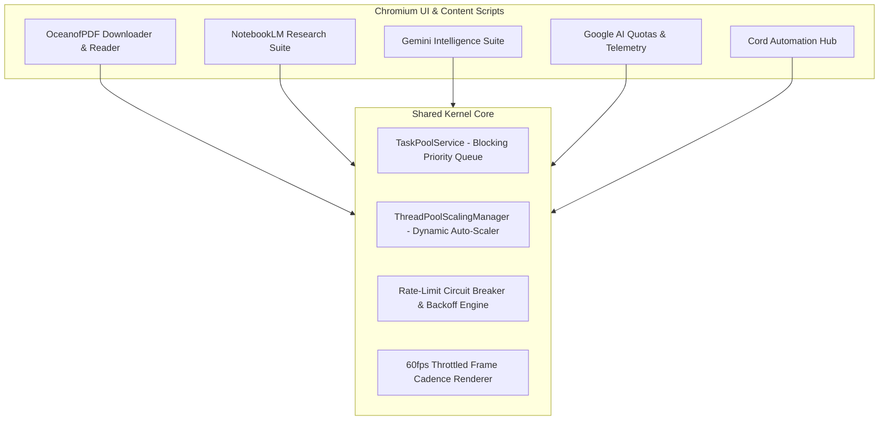
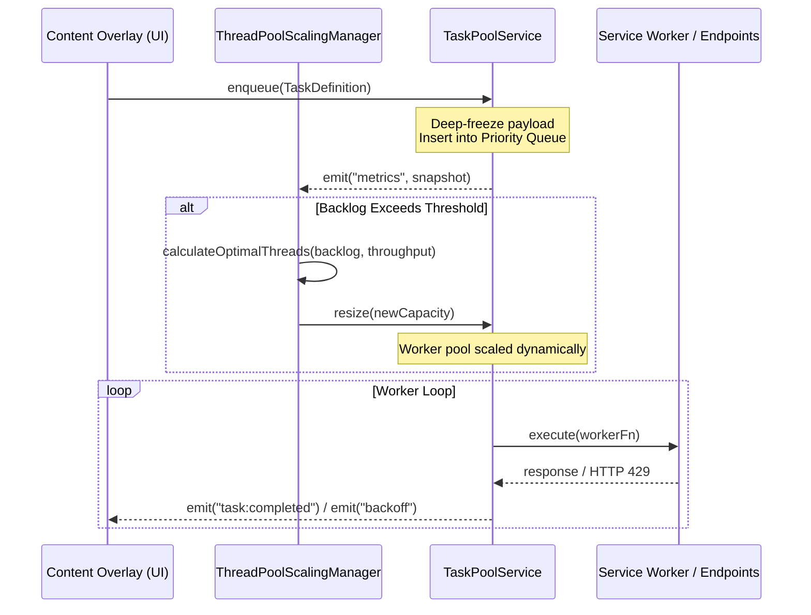

+++
title = "Enterprise Chromium Extension Ecosystem"
date = 2026-04-15
categories = ["Architecture", "Web Development", "Systems Engineering"]
tags = ["Manifest V3", "TypeScript", "Concurrency", "Worker Pools", "Chromium", "Native Messaging", "DOM MutationObserver"]
+++

## High-Throughput Concurrency in Manifest V3

Modern browser extensions operating under the Chromium Manifest V3 specification face strict architectural constraints: ephemeral service worker lifecycles, background execution quotas, and the constant risk of saturating the browser main thread during heavy data processing. This project is a monorepo ecosystem of five standalone Chromium extensions powered by a shared core kernel that provides deterministic task scheduling, dynamic worker pool auto-scaling, and persistent state recovery.

The ecosystem coordinates five purpose-built extensions through a centralized build compiler and a reusable internal architecture. Rather than relying on fragile DOM scraping scripts or ad-hoc background polling, each extension is designed as an event-driven system with rigorous interface separation between the UI presentation layer, the service worker coordination layer, and native host communication.



---

## Architectural Patterns and Shared Kernel Design

### Immutable Task Scheduling (`TaskPoolService`)

Workload execution is decoupled from the user interface using immutable task definitions. Every operation—whether resolving CDN download tokens, extracting markdown blocks, or indexing metadata—is packaged as a deep-frozen task payload. Once submitted, the payload cannot be mutated by concurrent workers, eliminating state races across background execution contexts.

The task scheduling engine implements a blocking priority queue with dual priority tiers. Urgent user operations, such as manual item retries or immediate foreground actions, jump to the front of the execution queue without starving background batch tasks. The scheduling algorithm maintains $O(1)$ enqueue time and amortized $O(\log N)$ extraction time, ensuring predictable throughput even under queues of several thousand items.

```javascript
// TaskPoolService immutable dispatch pattern
class TaskPoolService extends EventEmitter {
  enqueue(taskDefinition) {
    const immutableTask = Object.freeze({
      id: crypto.randomUUID(),
      priority: taskDefinition.priority ?? Priority.NORMAL,
      payload: Object.freeze({ ...taskDefinition.payload }),
      createdAt: Date.now()
    });

    this.priorityQueue.insert(immutableTask);
    this.emit('metrics', this.getTelemetrySnapshot());
    this.drain();
  }
}
```

### Dynamic Worker Pool Scaling (`ThreadPoolScalingManager`)

Browser environments operate under shifting CPU and memory constraints. The `ThreadPoolScalingManager` acts as a supervisory control loop that consumes real-time telemetry emitted by the task pool—monitoring queue depth, active worker count, completion throughput, and error frequency.

When queue backlogs increase and error rates remain nominal, the scaling manager dynamically increases active thread concurrency from a conservative baseline up to a configured safe ceiling of 16 concurrent workers. Conversely, if network latency spikes or upstream throttling is detected, the manager downscales pool capacity to prevent connection saturation. Telemetry broadcasts to the UI dashboard are formatted with fixed-width layout boundaries to eliminate visual layout jitter during high-frequency status transitions.



---

## Extension Suite Capabilities

### OceanofPDF Downloader & Reader (`_oceanpdf`)
Built for high-volume document retrieval and local library management. It implements a reactive dual-shelf split view separating queued downloads from completed titles, complete with book cover cards, an inspection side panel, and independent virtualized scrollbars. A rate-limiting circuit breaker monitors HTTP 429 and 503 challenge responses, initiating a synchronized countdown backoff timer across download workers while allowing metadata resolution tasks to proceed unimpeded.

### NotebookLM Research Suite (`_google-notebook`)
Automates deep research workflows by orchestrating structured note synthesis, source auto-naming via LLM topic summaries, and resilient DOM extraction that circumvents common mutation traps found in dynamic single-page web applications.

### Gemini Intelligence Suite (`_google-gemini`)
Integrates live conversation scraping, context window pruning, and debounced DOM observation to export clean markdown representations of multi-turn AI interactions without capturing ephemeral streaming artifacts.

### Google AI Usage & Quotas (`_google-ai-usage`)
Provides real-time API token telemetry and account quota tracking through dual-meter SVG circular indicators. It bridges the browser runtime to local operating system processes using standard Chromium Native Messaging RPC.

---

## Resilience, State Recovery, and Verification

Manifest V3 service workers can be terminated by the browser at any time due to inactivity. To ensure zero data loss during multi-hour ingestion runs, the ecosystem synchronizes operational state to `chrome.storage.local` on every task lifecycle transition.

A dedicated state recovery module provides full disaster recovery through drag-and-drop JSON state snapshots. Users can export their complete workspace, perform hard browser restarts or system reboots, and restore active queues precisely where they left off. High-frequency UI redraws are batched through a dedicated rendering pool locked to a 3-second cadence, ensuring smooth 60fps scrolling performance even during sustained multi-threaded network ingestion.

The entire browser ecosystem is validated by **162 passing automated unit tests** built with the Node.js test runner and JSDOM, covering mock DOM interactions, asynchronous timing invariants, dynamic worker pool scaling, and state serialization.

---

## Skills and Technologies

- **Languages & Runtimes**: TypeScript, Modern JavaScript (ES2024 / ESM), HTML5, CSS3.
- **Chromium Engineering**: Manifest V3, Web Extensions API, Service Workers, Content Scripts, DOM MutationObserver, Native Messaging Host, Shadow DOM.
- **Concurrency & Scheduling**: Dynamic Worker Pools, Blocking Priority Queues, Circuit Breakers, Exponential Backoff, Event-Driven Architecture.
- **UI Architecture & Performance**: Material Design 3, Virtualized Scrolling, 60fps Throttled Rendering Cadence, Zero-Jitter Status Telemetry.
- **Testing & Tooling**: Node.js Test Runner (`node:test`, `node:assert`), JSDOM Mocking, Monorepo Build Automation (`build-extension.mjs`).
