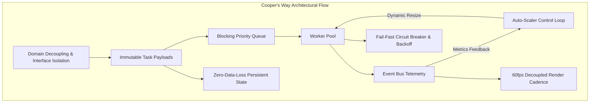

+++
title = "Cooper's Way"
description = "Architectural principles, concurrency invariants, and engineering directives"
date = 2026-06-15
categories = ["Architecture", "Engineering Standards"]
tags = ["Cooper's Way", "Design Patterns", "Immutability", "Concurrency", "Event-Driven", "Fail-Fast", "Resilience"]
+++

## Architectural Principles & Engineering Directives

Complex distributed systems, whether pricing equity derivatives or orchestrating asynchronous browser workers, tend to degrade when incidental complexity is introduced under the guise of cleverness. Over decades of designing and delivering platforms for global financial institutions, I have refined **Cooper's Way**—a unified set of architectural directives, concurrency invariants, and coding standards designed to keep software deterministic, observable, and easy to maintain.

At its foundation, Cooper's Way separates mechanical execution from strategic reasoning. Systems must be constructed from loosely coupled, behaviour-oriented interfaces where data flows through explicit pipelines rather than hidden, mutable state. When a codebase avoids implicit behavior and prioritizes readability over clever shortcuts, refactoring remains safe, bugs are isolated instantly, and systems scale gracefully.



---

## The Four Foundations

Every codebase developed under Cooper's Way is built upon four mutually reinforcing tenets:

1. **Single Responsibility Principle (SRP)**  
   Every module, class, and service must possess exactly one reason to change. Splitting coordination from mechanical processing guarantees that failures are localized and tests remain straightforward to reason about.

2. **Don't Repeat Yourself (DRY)**  
   Every piece of domain knowledge and business invariant must have a single authoritative home. Consolidating logic into shared abstractions prevents the subtle divergences that plague duplicated implementations over time.

3. **Keep It Simple (KISS)**  
   Complexity compounds exponentially. Resist the urge to engineer for hypothetical futures or build unnecessary abstraction layers. The optimal solution is the simplest implementation that comprehensively solves the real problem with zero ambiguity.

4. **Interface-Driven Design & Layered Isolation**  
   Core application logic depends strictly on abstractions, never on concrete implementations. Concrete types belong exclusively at composition roots. The architecture strictly delineates four layers:
   - **Domain Layer**: Pure entities, value objects, and domain interfaces with zero external library dependencies.
   - **Application Layer**: Use cases and orchestration workflows depending exclusively on domain contracts.
   - **Infrastructure Layer**: Concrete adapters for persistence, network protocols, native messaging, and third-party APIs.
   - **Composition Root**: The single wiring boundary responsible for assembling dependencies via constructor injection.

---

## Core Engineering Directives

### 1. Immutable Task Payloads
Every discrete unit of work—whether resolving a token, parsing an archive chunk, or executing a pricing scenario—is instantiated as an immutable data structure (`Object.freeze()` in TypeScript/JavaScript, unexported fields with value receivers in Go, or read-only records in C# and Java). In-place mutation is strictly prohibited; state transformations emit new snapshot objects. This invariant guarantees absolute thread-safety and eliminates race conditions across concurrent workers.

### 2. Event-Driven Domain Decoupling
Subsystems must not invoke peer services through synchronous direct couplings. Workloads communicate via asynchronous event buses, message dispatchers, or buffered channels. Worker pools publish periodic telemetry snapshots (`metrics`); external supervisory managers observe this telemetry and adjust concurrency thresholds independently, preserving clean domain boundaries.

```javascript
// Cooper's Way: Immutable task construction with frozen state
class TaskDefinition {
  static create(priority, payload) {
    return Object.freeze({
      id: crypto.randomUUID(),
      priority: priority ?? Priority.NORMAL,
      payload: Object.freeze({ ...payload }),
      createdAt: Date.now()
    });
  }
}
```

### 3. Dynamic Auto-Scaling with Blocking Priority Queues
Queues maintain $O(1)$ enqueue and amortized $O(\log N)$ extraction efficiency using dual-tier priority queues. Urgent foreground operations jump to the front of execution without starving long-running background tasks. A supervisory control loop monitors backlog depth and completion throughput, dynamically scaling worker capacity between validated safe boundaries.

### 4. Fail-Fast Error Handling and Circuit Breakers
Transient transport faults trigger bounded exponential backoff with randomized jitter to prevent thundering herd problems. Conversely, structural errors, invalid state transitions, or contract violations fail immediately and loudly, preserving contextual call stacks and routing failed items to visible dead-letter registries without interrupting unaffected pipeline streams.

### 5. Zero-Data-Loss State Persistence & Recovery
In-flight operational state is journaled to durable local storage (`chrome.storage.local`, SQLite, or append-only disk files) on every lifecycle state transition. If an execution host crashes, reboots, or is terminated by the operating system, complete recovery routines reconstruct active queues precisely from the last recorded checkpoint.

### 6. Decoupled Frame Cadence for User Interfaces
High-frequency worker events must never trigger synchronous UI redraws or layout calculations. A dedicated rendering pool batches telemetry updates onto a throttled frame cadence (e.g., 3-second intervals or `requestAnimationFrame` boundaries), eliminating layout thrashing and guaranteeing smooth 60fps scrolling performance during multi-threaded processing.

---

## Codebase Hygiene and Readability Rules

Cooper's Way enforces strict discipline regarding code structure and path handling:

- **Clarity Over Cleverness**: Code that cannot be understood at a glance must be rewritten.
- **Explicit Path Resolution**: Do not write implicit path logic that climbs arbitrary parent folders or guesses directory structures. Paths must be provided explicitly via configuration, dependency injection, or clearly defined root constants.
- **Pure Constructor Injection**: Dependencies are injected exclusively via constructors. Service locators, global registries, and static singletons are strictly prohibited.
- **Builder-Flow Interfaces**: Multi-step workflows utilize fluent builder-flow interfaces that enforce valid call order at compile time, eliminating temporal coupling and preventing partially initialized objects.
- **Strict Quality Constraints**: Production code contains zero commented-out code, no speculative placeholders, and no decorative emojis.

---

## Verification Discipline

Architectural tenets are meaningless without continuous automated verification. Systems built to Cooper's Way standards maintain comprehensive automated test suites:
- **Unit and Contract Tests**: Every interface, state transition, and parser is verified in isolation.
- **Concurrency & Race Detection**: Concurrent routines are profiled under simulated load and verified with race detection flags (`go test -race`).
- **Memory Allocation Audits**: Critical data paths are profiled via benchmarks and memory allocators (`pprof`, `sync.Pool`) to enforce constant space complexity ($O(1)$ allocations relative to dataset volume).

---

## Skills and Technologies

- **Architecture & Methodology**: Domain-Driven Design (DDD), Event-Driven Architecture, Ports & Adapters, CQRS, Builder-Flow Patterns, Cooper's Way Directives.
- **Concurrency & Resilience**: Worker Pools, Dynamic Rescaling Loops, Blocking Priority Queues, Circuit Breakers, Exponential Backoff with Jitter, `sync.Pool`.
- **State Management & Recovery**: Append-Only Journals, Checkpoint Persistence, Zero-Data-Loss State Recovery, Immutable Data Structures.
- **Engineering Quality**: Pure Dependency Injection, Interface Isolation, Table-Driven Testing, Concurrency Race Detection, Memory Profiling.
