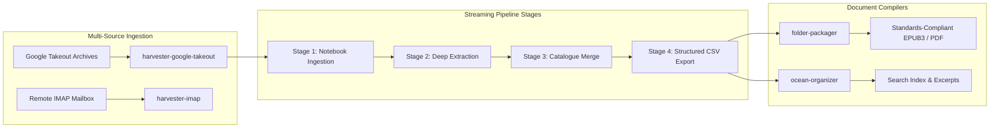

+++
title = "High-Performance Go Systems & Data Pipelines"
date = 2026-05-20
categories = ["Systems Engineering", "Architecture", "Cloud Infrastructure"]
tags = ["Go", "Streaming", "Concurrency", "Goroutines", "Native Messaging", "EPUB3", "IMAP", "sync.Pool"]
+++

## Zero-Allocation Stream Processing and Data Ingestion

Processing multi-gigabyte personal data archives and high-volume email mailboxes presents significant memory management and resilience challenges. In-memory object deserialization quickly leads to GC pauses, memory exhaustion, and unrecoverable failures when batch jobs crash midway through execution. This project encompasses a suite of high-throughput CLI utilities, concurrent stream parsers, and data ingestion microservices engineered in Go to achieve deterministic memory bounds, sub-millisecond inter-process communication, and resume-safe state execution.

The systems within this suite follow a common architectural philosophy: stream data wherever possible, enforce strictly bounded concurrency, recycle memory allocations via buffer pools, and preserve transactional state checkpoints so multi-hour operations can resume without duplicating work.



---

## Core Pipeline Architecture

### Multi-Stage Pipeline Framework (`harvester-google-takeout`)

The Google Takeout processing pipeline is architected around a decoupled **Pipeline Stage Registry Pattern**. Each discrete transformation step implements a shared Go interface defining lifecycle boundaries (`Execute`, `Rollback`, `State`):

```go
type Stage interface {
    Name() string
    Execute(ctx context.Context, state *PipelineState) error
}
```

To eliminate memory spikes when ingesting multi-gigabyte JSON archives, the framework avoids loading entire payloads into memory. Instead, it utilizes streaming JSON tokenizers (`json.Decoder`) coupled with a shared `sync.Pool` of reusable byte buffers. Memory consumption remains constant ($O(1)$ space complexity relative to total archive size), allowing multi-gigabyte datasets to be parsed with a minimal memory footprint.

Execution progress is committed deterministically to a local state journal (`.takeout-pipeline-state.json`). If a network connection drops or the process receives an interruption signal, execution resumes from the last completed stage rather than re-ingesting previous artifacts.

```go
// Buffer recycling pattern for zero-allocation streaming
var bufferPool = sync.Pool{
    New: func() any {
        return bytes.NewBuffer(make([]byte, 0, 64*1024))
    },
}

func StreamDecodeRecords(r io.Reader, handleRecord func(Record) error) error {
    dec := json.NewDecoder(r)
    buf := bufferPool.Get().(*bytes.Buffer)
    defer func() {
        buf.Reset()
        bufferPool.Put(buf)
    }()

    for dec.More() {
        var rec Record
        if err := dec.Decode(&rec); err != nil {
            return fmt.Errorf("decoding record: %w", err)
        }
        if err := handleRecord(rec); err != nil {
            return err
        }
    }
    return nil
}
```

### Bounded Concurrent IMAP Harvester (`harvester-imap`)

The email ingestion engine establishes parallel connection sessions to remote IMAP mailboxes to extract, parse, and archive RFC-822 messages and multi-part attachments. 

Concurrency is governed by a bounded worker pool leveraging Go channels as counting semaphores. This prevents the worker routines from overwhelming remote mail servers or triggering rate limits. The connection manager features automated TLS session renegotiation, backoff retry loops on transient transport dropouts, and direct-to-disk streaming for binary attachments to prevent large payloads from dwelling in application heap memory.

---

## Compilation, Indexing, and Native Messaging

### Programmatic EPUB3 & PDF Compiler (`folder-packager`)

The `folder-packager` compiler synthesizes unstructured document folders into standards-compliant Open Container Format (OCF) EPUB3 publications and formatted PDFs. The compiler programmatically builds:
- XML package manifests (`content.opf` and `toc.ncx`) adhering strictly to the International Digital Publishing Forum (IDPF) standard.
- Embedded CSS typographic layouts optimized for e-ink and mobile readers.
- Automated heuristic content sanitization that filters navigational artifacts, boilerplate markers, and broken hyperlinks.

### Document Classifier & Indexer (`ocean-organizer`)

Engineered for fast document indexing across deeply nested directory structures. By executing directory traversal across concurrent worker goroutines, the indexer evaluates file signatures and generates high-entropy text abstracts, genre tags, and semantic slugs across thousands of files per second.

### Chromium Native Messaging Host (`agy_host`)

The ecosystem includes a compiled Go binary that interfaces directly with Chromium browser extensions via the standard Native Messaging protocol. The binary reads length-prefixed standard input frames formatted with a 4-byte little-endian header followed by UTF-8 encoded JSON payloads:

$$\text{Frame} = [\text{uint32 length}][\text{JSON payload}]$$

This architecture allows the browser extension to query local OS disk usage, token telemetry, and background job status with sub-millisecond roundtrip latency, bridging the security sandbox of the browser with the native operating system.

---

## Skills and Technologies

- **Languages & Core**: Go (Golang 1.21+), Standard Library Concurrency (`sync`, `sync/atomic`, `sync.Pool`), Channels.
- **Data Engineering**: Streaming JSON Parsers (`json.Decoder`), RFC-822 IMAP Ingestion, EPUB3 OCF Specifications, XML Manifest Generation.
- **Concurrency & Resilience**: Bounded Goroutine Worker Pools, Context Cancellation, Deterministic Checkpoint State Engines, TLS Renegotiation.
- **Inter-Process Communication**: Chromium Native Messaging Host Protocol, Standard I/O RPC, Low-Latency Serialization.
- **Testing & Profiling**: Go Benchmark Suite (`testing.B`), Memory Allocation Profiling (`pprof`), Race Detector (`-race`).
