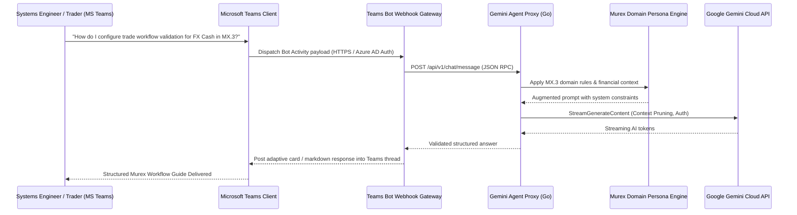

+++
title = "Murex Capital Markets AI Agent & LLM Proxy"
date = 2026-06-01
categories = ["AI/ML", "Finance", "Architecture"]
tags = ["Murex MX.3", "Go", "Gemini API", "LLM Proxy", "Capital Markets", "Microsoft Teams", "Enterprise Bot", "Streaming"]
+++

## Domain-Calibrated Enterprise AI for Capital Markets

Trading platforms such as Murex MX.3 form the core computational backbone of tier-one investment banks, governing trade booking, market risk, and post-trade lifecycle workflows. However, configuring, troubleshooting, and operating these platforms requires specialized institutional knowledge spanning financial mathematics, proprietary scripting syntaxes, and complex database schemas.

In institutional banking environments, operational workflows must comply with stringent communication and compliance policies. Commercial messaging tools are strictly prohibited for trade-related discussions; all communication must flow through monitored, bank-approved collaboration infrastructure.

This project delivers an enterprise integration bridge enabling financial engineers, traders, and platform operators to interact with a dedicated AI copilot specifically calibrated for Murex MX.3 directly through **Microsoft Teams**. The system combines an enterprise Teams bot gateway, a lightweight Go proxy microservice, and a domain-specific persona validation engine that interfaces with the Google Gemini API to deliver accurate, syntax-verified operational guidance within secured corporate channels.



---

## Architecture and Core Components

### Gemini Agent Proxy (`gemini-agent-proxy`)

The server-side proxy is authored in Go using only the standard library (`net/http`, `context`, `encoding/json`), maintaining zero external runtime dependencies for maximum auditability and ease of deployment within secured enterprise perimeter networks.

The proxy is responsible for:
- **Dynamic Context Window Pruning**: As conversations progress, the proxy analyzes historical token volume and strategically prunes older conversational turns while permanently pinning the root system instructions and active financial domain state. This prevents context exhaustion while controlling cloud API token consumption.
- **Resilient Upstream Streaming**: Connects to the Google Gemini API via streaming HTTP/2 endpoints, buffering and validating tokens before dispatching structured chunks back to the client interface.
- **Fail-Safe Error Translation**: Upstream HTTP 429 rate limits, network timeouts, and quota exhaustion events are intercepted and translated into human-readable, actionable diagnostic messages rather than raw stack traces.

```go
// Dynamic context pruning and prompt construction
type ChatContext struct {
    SystemPrompt string        `json:"system_prompt"`
    Messages     []ChatMessage `json:"messages"`
    MaxTokens    int           `json:"max_tokens"`
}

func (c *ChatContext) PruneHistory(targetTokenLimit int) {
    total := estimateTokens(c.SystemPrompt)
    for i := len(c.Messages) - 1; i >= 0; i-- {
        tokens := estimateTokens(c.Messages[i].Content)
        if total+tokens > targetTokenLimit {
            c.Messages = c.Messages[i+1:]
            return
        }
        total += tokens
    }
}
```

### Murex Domain Persona Engine (`internal/persona`)

Standard commercial large language models often hallucinate nonexistent parameters or blend syntax from unrelated trading systems when queried about specialized enterprise financial software. The domain persona engine eliminates this vulnerability by enforcing a strict domain vocabulary covering:
- **Capital Markets Asset Classes**: Foreign Exchange (FX Cash, FX Options), Interest Rate Derivatives (IRS, Swaps, FRA), Credit, and Fixed Income instruments.
- **Murex Operational Architecture**: Pre-trade validation workflows, Trade Insertion API (TIA), Datamart reporting extraction, Accounting Engine rules, and VaR calculation configurations.
- **Syntax Verification**: Scripting commands, XML configurations, and system flags generated by the model are parsed against an internal grammar to verify accuracy before being delivered to the engineer.

### Microsoft Teams Bot Gateway (`teams-bot-gateway`)

To integrate seamlessly into regulated bank workflows, the interface connects directly to internal Microsoft Teams channels and direct messaging threads via the enterprise Bot Framework protocol:
- **Enterprise Identity & Authorization**: Validates incoming requests against corporate Azure Active Directory (AAD) tenant tokens, ensuring queries originate exclusively from authorized bank personnel.
- **Adaptive Card Formatting**: Formats complex multi-part responses into structured Adaptive Cards with syntax-highlighted XML/script blocks, copyable configuration snippets, and collapsible reference sections.
- **Threaded Context Continuity**: Correlates chat conversations by Teams conversation ID, preserving context across collaborative incident troubleshooting sessions within specialized support channels.

---

## Resilience and Operational Controls

In financial trading infrastructure, reliability and compliance are paramount. The system implements multiple defense-in-depth measures:
- **Read-Only Advisory Guardrails**: The agent acts strictly as an operational advisor and configuration validator; it does not execute autonomous state-altering operations directly against production trading databases.
- **Regulatory Recordkeeping Compliance**: Every interaction is transmitted through standard corporate channels subject to existing bank compliance archiving, meeting regulatory audit requirements (FINRA, SEC, FCA).
- **Deterministic Token Budgeting**: Model interactions are bounded by strict execution budgets, preventing run-away token expenditures during complex troubleshooting sessions.
- **Clean Audit Trail**: Every query, prompt augmentation, and delivered response is indexed to a structured local log with anonymized actor identifiers for post-incident review and audit compliance.

---

## Skills and Technologies

- **Languages & Frameworks**: Go (Golang 1.21+), Microsoft Teams Bot Framework, JSON RPC, REST APIs.
- **AI & LLM Orchestration**: Google Gemini 1.5 Pro / Flash API, Dynamic Context Window Pruning, Structured Prompt Calibration.
- **Capital Markets Domain**: Murex MX.3 Platform Architecture, Datamart, Trade Insertion API, Workflow Engine, FX & Interest Rate Derivatives.
- **Enterprise Security & Infrastructure**: Azure Active Directory (AAD), OAuth2 / JWT Authentication, TLS Mutual Auth, Zero-Dependency Microservices.
- **Reliability & Testing**: Table-Driven Unit Testing, Syntax Validation Engines, Fault Injection and Upstream Timeout Handling.
