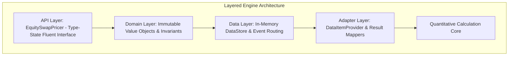
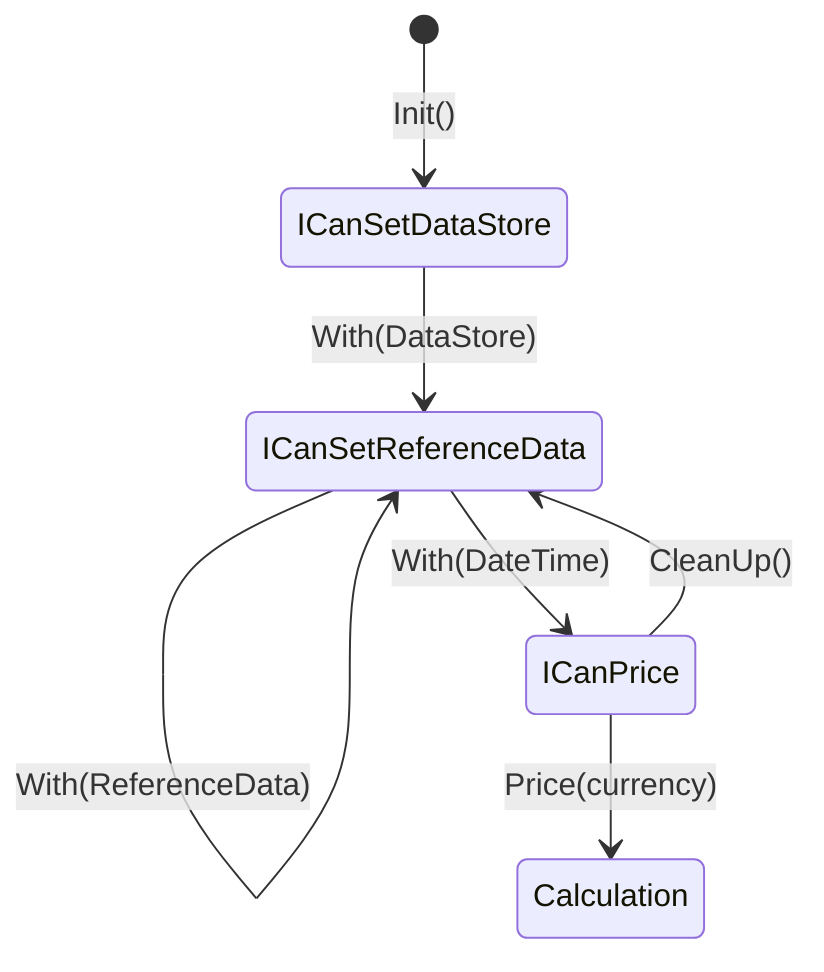

+++
title = "Production Equity Swap Pricing Engine"
date = 2026-02-20
categories = ["FinTech", "Architecture", "Systems Engineering"]
tags = ["C#", ".NET", "Derivatives", "Quantitative Finance", "Type-State Pattern", "Domain-Driven Design", "xUnit"]
+++

## High-Performance Equity Derivative Valuation in C#

Valuing complex financial derivatives requires bridging two conflicting engineering paradigms: low-level, high-throughput quantitative calculation libraries and high-level, maintainable enterprise domain architectures. Many quantitative engines expose unmanaged, handle-based APIs that rely on manual memory marshaling, implicit ordering conventions, and untyped pointer structures. When exposed directly to application developers, these interfaces lead to memory leaks, invalid state combinations, and unrepeatable calculation runs.

This project is a high-performance C# / .NET library engineered to encapsulate a quantitative equity derivative calculation engine behind an immutable, type-safe domain model. By encoding business workflows and calculation prerequisites directly into the compiler via the **Type-State Pattern**, the library transforms an error-prone calculation pipeline into a self-documenting, fluent API where invalid calculation sequences are compile-time impossibilities.

In automated test suites benchmarked against a corpus of 24,615 live market positions, the library achieved a **97.8% pass rate across a 5,000-position sampled test suite**, calculating Present Value (PV) and key Greek sensitivities (Delta, Gamma, Vega, Theta) with sub-millisecond per-position execution times.



---

## Architectural Patterns and Domain Model

### Compile-Time Correctness via the Type-State Pattern

The core architectural innovation of the library is its use of the **Type-State Pattern** to manage state progression. Rather than verifying prerequisites at runtime with conditional checks, workflow states are represented by dedicated interfaces:



Each method in the builder chain returns the specific interface permitted for the subsequent stage. The developer cannot invoke `.Price()` without first supplying an active data store, contract specification, market data inputs, position sizing, and pricing timestamp. This eliminates runtime state validation exceptions and guarantees that only fully configured, structurally valid positions reach the calculation engine.

```csharp
// Type-safe calculation workflow
var pricer = EquitySwapPricer.Init(configPath, licensePath);

Calculation calculation = pricer
    .With(new DataStore())
    .With(swapContract)
    .With(marketData)
    .With(contractPosition)
    .With(DateTime.UtcNow)
    .Price(currency: "USD");

if (calculation.Success())
{
    var pv = calculation.Get(new Pv());
    var delta = calculation.Get(new CashDelta());
    var vega = calculation.Get(new Vega());
}
```

### Domain-Driven Design: Strict Separation of Contract and Position

A critical design challenge in derivative modeling is distinguishing between contract terms and signed portfolio exposure. International Swaps and Derivatives Association (ISDA) market standards mandate that contract notional is strictly positive; trade direction is a legal construct, not a sign on notional value. Many naive systems encode short positions by assigning negative notional values, violating database constraints and triggering numerical instability in downstream compounding engines.

The library solves this by cleanly separating `SwapContract` from `ContractPosition`:
- **`SwapContract`**: An immutable record encapsulating symmetric contract parameters (underlying asset, currencies, day-count convention, spread, initial equity and FX fixings). Contract notional is invariant-checked to remain strictly positive ($O(1)$ validation).
- **`ContractPosition`**: A directional wrapper associating a contract with a signed integer quantity. A positive quantity denotes long exposure (receiving equity returns and paying financing), while a negative quantity denotes short exposure (paying equity returns and receiving financing income).
- **`ContractMarketData`**: Contains spot prices, FX spot pairs, and historical fixing tables, linked directly to the contract via deterministic content-based identifiers.

All domain records implement value-based equality with deterministic hashing, allowing contracts and market data snapshots to serve as cache keys across distributed memory stores without key collisions.

---

## Layered System Implementation

### In-Memory Partitioned DataStore and Event Routing

The data management layer (`DataStore`) isolates in-memory state into four distinct functional partitions: instrument specifications, market data points, position records, and historical fixing snapshots. 

When domain items are added to the store, an internal router maps each item by origin and emits observable lifecycle events (`BeforeDataSave`, `AfterDataSave`). This enables comprehensive audit logging, telemetry monitoring, and validation tracking without coupling the core domain logic to monitoring infrastructure. A session-scoped cleanup mechanism (`RemoveAll`) purges memory allocated during a calculation run, eliminating memory leaks in high-frequency batch processing.

### Adapter Transformation Layer

The quantitative calculation engine requires specialized memory layouts and internal handle registrations. The adapter layer uses the **Template Method Pattern** across abstract base classes (`DataItemProvider<T>` and `HeadLineResultsBase<T>`):
- The base provider manages unmanaged handle allocation, session lifecycles, and error trapping.
- Specific concrete adapters implement the domain-to-engine field mappings and result extractions.

This pattern insulates the core C# domain model from proprietary calculation engine interfaces, making it possible to substitute alternative valuation backends without modifying business code.

### Comprehensive Validation Pipeline

Before any record is transformed for calculation, it passes through a layered validation framework consisting of over 25 discrete validation rules:
- **FX Market Conventions**: Enforces standard currency orientation (e.g., EUR/USD, GBP/USD), detects duplicate currency quotes, and verifies identity self-pairs.
- **Cross-Currency Arithmetic**: Verifies quanto and composite swap currency triangulation rules.
- **Tenor and Fixing Integrity**: Validates holiday calendar intervals, day-count fraction calculations, and equity/FX fixing consistency.

---

## Verification and Benchmark Testing

The library was verified using a comprehensive testing hierarchy built with xUnit, adhering strictly to the Arrange-Act-Assert (AAA) pattern:

1. **Unit Test Suite**: Covers individual validation rules, mathematical date-fraction calculations, property deductions, and object equality invariants.
2. **5,000-Position Production Benchmark**: Evaluated against an external dataset of 24,615 live market swaps spanning single stocks, equity indices, ETFs, and cross-currency structures. Using reservoir sampling to select 5,000 unbiased positions, the test runner executed automated end-to-end pricing comparisons against expected quantitative benchmarks, achieving an overall **97.8% pass rate**.
3. **Thread-Safety & Concurrency**: The calculation engine initialization is protected by thread-safe double-checked singleton locks, allowing multiple concurrent worker threads to price independent positions simultaneously without resource contention.

---

## Skills and Technologies

- **Languages & Frameworks**: C# 12, .NET 8 / .NET Framework, Language-Integrated Query (LINQ).
- **Architectural Patterns**: Type-State Pattern, Fluent Builder, Template Method, Provider Pattern, Domain-Driven Design (DDD).
- **Financial Engineering**: Equity Total Return Swaps, ISDA Market Conventions, Greeks Valuation (PV, Delta, Gamma, Vega, Theta), Cross-Currency Quantos.
- **Concurrency & Memory**: Thread-Safe Singleton Initializers, Lazy Evaluation (`Lazy<T>`), In-Memory Partitioned Caches, Unmanaged Handle Abstraction.
- **Testing & Verification**: xUnit, Reservoir Sampling, Property Initializers, Arrange-Act-Assert (AAA) Test Discipline.
